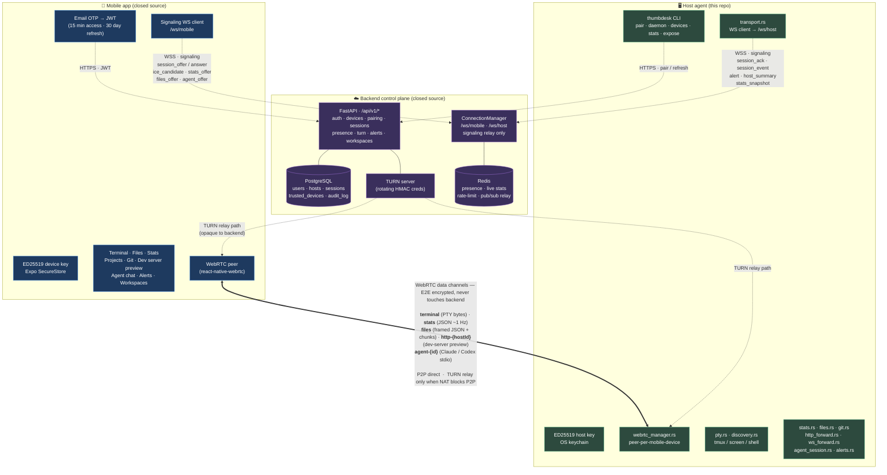
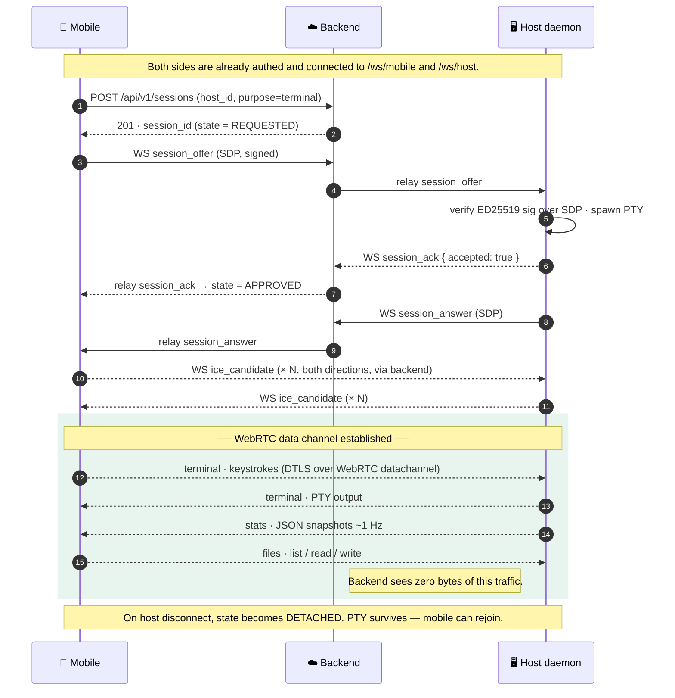

# Thumbdesk
> A real terminal in your pocket, with authenticated WebRTC.

Thumbdesk turns your phone into a real PTY for the machines you care about — your dev box, a homelab Pi, a fleet of edge servers. On the preferred direct or TURN-relayed WebRTC path, traffic is protected by DTLS end to end. While WebRTC is unavailable, terminal and coding-agent traffic can use a server-readable WSS/TLS fallback; file signaling has a separate key-exchange fallback documented in the [security architecture](https://thumbdesk.com/security/).

**Get Thumbdesk:** [App Store](https://apps.apple.com/us/app/pocketshell/id6764135099) · [Google Play](https://play.google.com/store/apps/details?id=app.pocketshell.mobile) · [Website](https://thumbdesk.com/)

This repository is the **public releases channel** for the Thumbdesk host agent, the program that runs on the machine you want to reach: signed release binaries, install packaging, and the npm wrapper. The host agent's source is not published going forward. The mobile apps (iOS / Android) and the backend control plane that brokers pairing and signaling are closed-source too.

```
┌──────────┐                         ┌──────────────┐                          ┌──────────┐
│  mobile  │ ──── auth · signal ──── │   backend    │ ──── auth · signal ──── │   host   │
│ (closed) │                         │   (closed)   │                          │  (agent) │
└────┬─────┘                         └──────────────┘                          └────┬─────┘
     │                                                                              │
     └──── WebRTC datachannel (DTLS) · ED25519-pinned SDP transcript ──── PTY ───┘
                       (preferred terminal path; fallback documented separately)
```

On authenticated WebRTC sessions, the backend cannot substitute a peer: the DTLS certificate fingerprint is bound into a signed SDP transcript verified against the device's long-term ED25519 pairing key. Direct and TURN-relayed WebRTC payloads are end-to-end encrypted. The backend also handles presence, alerts, lightweight metric history, and WSS/TLS fallbacks. Terminal and agent fallback frames are server-readable while relayed. Signaling-based file operations normally add ChaCha20-Poly1305 with X25519/HKDF-derived keys, but the current client can fall back to WSS/TLS if file key exchange fails. See the [security architecture](https://thumbdesk.com/security/) for exact data paths and limitations.

> Host↔host direct file transfer (a Pro feature) is anchored to the mobile device as introducer: the phone signs an attestation binding both hosts' long-term public keys to the transfer, and each host verifies it against the mobile pubkey pinned at pairing — so the backend can relay SDP but cannot substitute a peer's identity. See [Security model](#security-model).

---

## What's in this repo

```
packaging/
  debian/         # debian package + systemd unit
  macos/          # launchd plist
homebrew/         # the Homebrew cask, published to yashagldit/homebrew-thumbdesk
npm/              # the `thumbdesk` and `pocketshell` npm wrapper packages
LICENSE           # Apache-2.0 (covers the code published here)
NOTICE            # attribution per Apache-2.0 §4(d)
```

Releases, with their SHA-256 checksums and Sigstore signatures, are on the [Releases page](https://github.com/yashagldit/PocketShell/releases). This repository keeps its original name (`PocketShell`) because agents already installed update from it.

---

## Install

### Pre-built binaries

Pick one (the older `pocketshell` command keeps working as an alias):

```bash
# Homebrew — macOS (Apple Silicon, macOS 13+): the Thumbdesk app + the command
brew install --cask yashagldit/thumbdesk/thumbdesk

# install script — macOS & Linux
brew install cosign  # one-time, for Sigstore signature verification
curl -fsSL https://thumbdesk.com/install.sh | bash

# npm — macOS, Linux & Windows
npm i -g thumbdesk
```

**Install script** (macOS / Linux) detects your OS and arch, fetches the
matching tarball from the latest [GitHub
Release](https://github.com/yashagldit/PocketShell/releases), verifies
its SHA-256 checksum **and the Sigstore cosign keyless signature**
(pinned to this repo's release workflow identity), then installs to
`~/.local/bin/thumbdesk` (or `/usr/local/bin/thumbdesk` if run as
root). Without cosign installed the script refuses to proceed — the
SHA-256 alone is same-origin integrity, not authenticity, so a
compromised release publisher could serve a matching checksum for a
malicious binary. Set `THUMBDESK_SKIP_COSIGN=1` only if you've
verified the artifact out of band. It's a POSIX shell script — on
**Windows** use npm (below).

Read the script first if you'd rather not pipe to bash blindly — it's
served from the static site and intentionally short.

**npm** ships the binary inside platform-specific packages
(`@pocketshell/darwin-arm64`, `@pocketshell/linux-x64-gnu`,
`@pocketshell/win32-x64-msvc`, etc.) selected by npm's `os` / `cpu` /
`libc` filters — this is the **recommended path on Windows**. The
packages are published from this repo's release workflow via [npm Trusted
Publishing](https://docs.npmjs.com/trusted-publishers/) (OIDC, no
long-lived tokens), with build provenance attached automatically.

Verify either install:

```bash
thumbdesk --version
```

### Building from source

Not supported: the host agent is closed source going forward, and
Thumbdesk's backend is not self-hostable. Use the signed pre-built
binaries above.

## Pair and run

Pairing is QR-based — run `thumbdesk pair` on the host, scan the QR from the mobile app.

```bash
# 1. on the host, generate a pairing QR (prints to the terminal)
thumbdesk pair

# 2. in the Thumbdesk app: Hosts → Add host → "Scan Host QR"
#    point the camera at the QR shown in step 1

# 3. start the daemon (runs as your user, not root)
thumbdesk daemon start                           # linux / macOS — installs a user service

#    windows: the background service isn't wired up yet, so run it in the
#    foreground in a terminal you keep open instead of `daemon start`:
thumbdesk daemon run                             # windows

# 4. status & logs
thumbdesk daemon status
journalctl --user -fu thumbdesk-host-agent      # linux
log stream --predicate 'process == "thumbdesk"' # macOS
#    windows: logs stream to the console running `daemon run`
```

The QR carries a short-lived claim plus the host's public key, so the mobile app pins the host identity at pair time rather than trusting a backend-relayed field. To re-pair an existing host onto a different account, run `thumbdesk pair --reset` — this wipes the local identity before generating a fresh QR.

The daemon connects out to the signaling backend over WSS and waits for a peer offer. When your phone wants a session, the backend signals; the data channel is end-to-end encrypted between phone and host.

---

## Project workspace, Git, and dev servers

Thumbdesk's host agent now supports the mobile project workspace in addition to raw terminal access:

- **Projects.** The agent discovers recent Claude Code and Codex project directories from local session metadata, returns a capped project tree for the mobile sidebar, and supports filename/content search while skipping heavy directories such as `.git` and `node_modules`.
- **Git.** The mobile app can inspect repository status, view diffs and commit history, stage/unstage/discard files, commit, pull, push, list branches, and switch or create branches. Mutating actions are audited locally on the host.
- **Local dev-server preview.** The mobile app can render a local web app running on the host, such as Vite, Next.js, webpack-dev-server, Rails, Django, or Flask. HTTP, Server-Sent Events, and WebSocket traffic tunnel over the encrypted WebRTC data channel, so HMR and framework error overlays work in the in-app preview.

Dev-server access is deny-by-default. A port must be exposed before the mobile app can forward requests to `localhost:<port>`:

```bash
# persistent until removed
thumbdesk expose 5173

# temporary; automatically purged on daemon restart
thumbdesk expose 5173 --ephemeral

thumbdesk exposed
thumbdesk unexpose 5173
```

The app can also discover locally listening HTTP servers and request an ephemeral expose in-app. The daemon re-checks permissions for each expose/unexpose request and records audit events for expose, unexpose, and forwarded HTTP/WebSocket attempts.

---

## How it works

Two planes, deliberately separated. The **control plane** (HTTPS + WebSocket to the backend) carries auth, pairing, presence, SDP offers / answers, and ICE candidates; sensitive signaling messages (file metadata) get an additional ChaCha20-Poly1305 envelope with X25519-derived keys so the backend WS sees only ciphertext. The **data plane** (WebRTC peer connection) carries every byte of your shell — PTY I/O, file chunks, stats samples, agent stdio — directly between phone and host, encrypted by DTLS at the WebRTC layer with the peer cert fingerprint bound into the ED25519-signed SDP.



### Session establishment (the happy path)



### What flows where

| Plane | Carrier | Payload |
|---|---|---|
| Auth | HTTPS `/api/v1/auth/*` | OTP, JWT issue / refresh, host pair / re-auth |
| Signaling | WSS `/ws/mobile`, `/ws/host` | `session_offer` · `session_answer` · `ice_candidate` · `session_event` · `stats_offer` · `files_offer` · `agent_offer` · `alert` · `host_summary` · `available_sessions` |
| Presence + lightweight metrics | WSS `/ws/host` | `heartbeat` (host_id, active_sessions, app_version) · `host_summary` (cpu%, ram%) · `stats_snapshot` and `stats_minute_batch` (cpu/mem/disk/load/battery/net IO/temps — **no processes, no command lines, no logged-in users**) |
| Metrics history (Pro) | HTTPS `/api/v1/presence/hosts/{id}/stats/history*` | minute / 30-min / hourly / daily aggregates served from PostgreSQL — used by the history charts even when no live session is active |
| **Terminal I/O (preferred)** | **WebRTC `terminal` channel** | **PTY bytes protected by DTLS; the backend is not in this channel** |
| **Live stats (rich)** | **WebRTC `stats` channel** | **Top-50 processes · per-core CPU · logged-in users · network connections · OS info · hostname — never touches backend** |
| **File, project, and Git ops** | **WebRTC `files` channel** | **Framed JSON + base64 chunks (sentinel `\x00PSFC`) · project discovery/tree/search · git status/diff/log/stage/commit/pull/push/branch** |
| **Dev-server preview** | **WebRTC `http-{hostId}` channel** | **HTTP requests, response streams, SSE, and WebSocket/HMR frames forwarded to exposed `localhost:<port>` only** |
| **Agent chat** | **WebRTC `agent-{id}` channel** | **Claude / Codex stdio, JSON framed** |
| Terminal + agent fallback | WSS signaling | Server-readable TLS-protected frames while WebRTC is starting or unavailable; mobile-to-host frames are signed and replay-checked |
| File signaling fallback | WSS signaling | Normally X25519/HKDF/ChaCha20-Poly1305 encrypted; the current client can fail over to server-readable TLS if key exchange fails. Large streams require WebRTC |

On the authenticated WebRTC channels, the backend sees ciphertext at most through TURN and nothing on direct P2P. The WSS fallbacks above have different visibility and are not end-to-end encrypted.

**What the backend persists.** To deliver the Pro history-chart feature, the backend stores minute-bucket aggregates of numerical metrics (cpu/mem/disk/uptime/load/battery/net IO/disk IO/max temp + collected-at) per host, rolled up into 30-min/hourly/daily over time. It does **not** persist processes, command lines, hostnames, logged-in users, or network connection lists — those flow only over WebRTC and are dropped from Redis after ~35 minutes. Account deletion removes all of the above; see `app/services/account_deletion_service.py`.

---

## Security model

| Layer | Primitive |
|---|---|
| Identity | ED25519 long-term host & device keys |
| Handshake | X25519 ephemeral · ED25519-signed SDP transcript binds DTLS cert fingerprint to the device pairing key |
| Data plane | WebRTC DTLS (transport encryption — AES-GCM by default, ciphersuite negotiated) |
| Signaling envelope | ChaCha20-Poly1305 AEAD · per-direction keys (wraps sensitive file/control payloads that pass through the backend WS) |
| KDF | HKDF-SHA256, domain-separated |
| Transport | WebRTC P2P · TURN fallback (rotating credentials) |
| Storage | OS keychain — Apple Keychain · Linux secret-service · Windows DPAPI · 0o600 file fallback for headless Linux |

Long-lived secrets (host private key, refresh token) live in the OS keychain via `crates/host-core/src/secret_store.rs`. Short-lived access tokens sit in `state.json` (mode `0o600`).

### Host↔host transfer trust model

The destination host verifies the source's SDP signature against a public key carried inside a *mobile-signed introducer attestation*, not a backend-relayed field. At transfer-initiation time the mobile app signs `(transfer_id, src_host_id, src_host_pubkey, dst_host_id, dst_host_pubkey, expires_at, nonce)` with its long-term device key; both hosts verify that signature against the mobile pubkey they pinned at pairing. The attestation is short-lived (≤ 5 min), bound to a single `transfer_id`, and both hosts additionally check that their own `host_id`+`public_key` match the attested values. Backend can relay SDP but cannot substitute a peer's identity. See `crates/host-core/src/signaling_crypto.rs` (`verify_host_transfer_attestation`) and `crates/host-core/src/daemon.rs` (`extract_and_verify_mobile_attestation`).

### Known gaps

- **No per-session approval prompt (by design)** — once a mobile device is trusted, every session offer is accepted immediately. The stolen-and-unlocked-phone case is handled by layered controls instead: app open is gated by device biometric, every paired device shows up in the in-app device list and can be revoked remotely from any other paired device, and sensitive ops are written to the local audit log on the host. Adding a per-session prompt would train users to tap "approve" reflexively and degrade the UX for the common case, so it isn't on the roadmap.

Found something? Email `support@thumbdesk.com`. Public issues are fine for non-sensitive bugs.

---

## Feedback

Issues for the host agent are welcome on this repository; we can't take code contributions here since the source is not published. Issues for the mobile app or the backend are redirected to support@thumbdesk.com.

---

## License

Licensed under the [Apache License, Version 2.0](./LICENSE).

See also [NOTICE](./NOTICE).

---

**Links** · [thumbdesk.com](https://thumbdesk.com/) · [App Store](https://apps.apple.com/us/app/pocketshell/id6764135099) · [Google Play](https://play.google.com/store/apps/details?id=app.pocketshell.mobile) · [Security](https://thumbdesk.com/security/) · [Privacy](https://thumbdesk.com/privacy/) · [Terms](https://thumbdesk.com/terms/) · [Support](https://thumbdesk.com/support/)
